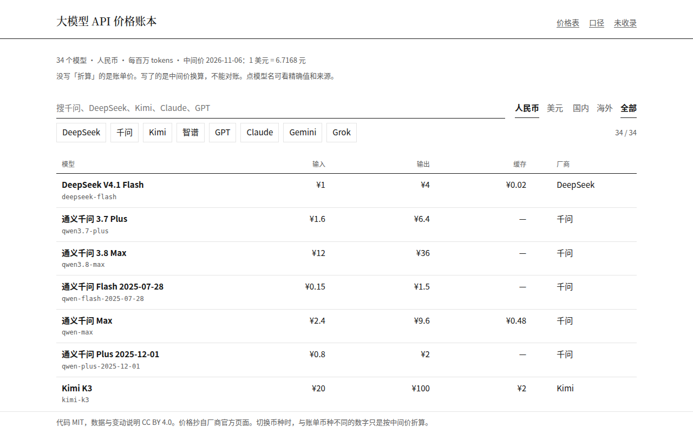

# 大模型 API 价格账本

在线查阅：<https://liaoruochen555-rgb.github.io/ai-model-ledger/>

国产模型放在前面的 LLM API 标价账本。每条价格都有官方来源和核验日，改价只追加、不覆盖。



这不是跑分榜，也不是渠道报价单。它回答三件事：这个模型 ID 现在的官方入口价是多少，上下文窗口页面上怎么写，上次核验之后价变过没有。

## 和现有价格表的差别

界面是中文的。每条价格旁边是官方来源和核验日。历史只追加，不覆盖。账单不是人民币时，折算用的汇率、日期，以及这不是发票金额，都写在明处。

- 深度求索、通义千问、Kimi、智谱和 OpenAI、Claude、Gemini、Grok 放在同一张表里，国内厂商排在前面。
- 一条记录对应一个 API 模型 ID，价格旁边是来源 URL 和核验日。
- 历史文件和按日快照都是只追加的。入口价、峰谷、长上下文和限时价分开记，不折成一个平均数。
- 账单是美元时，人民币数字按写明日期的汇率中间价折算，并标明这不是发票金额。厂商若另行公布另一种货币，单独列出，不把它写成折算结果。

v0.1 收录 34 个能在官方页面上逐项核对的模型。OpenAI 现行 Standard 表从 Astra、6.1 Sol、6.1 Terra、6 Sol 到 5.6 Sol / Terra / Luna 和 6 Luna 都在；已弃用的 gpt-5、gpt-4.1 单独标出，不代替这些在售型号。其他厂商同样保留中间档，而不只是一档最贵和一档最便宜。深度求索仍只有 Flash：Pro 的定价页和停用公告互相冲突。核对不到的宁可不收，清单在 [docs/omitted.md](docs/omitted.md)。口径在 [docs/methodology.md](docs/methodology.md)。

## 仓库里有什么

| 路径 | 内容 |
| --- | --- |
| `data/models/` | 当前价，一个模型一个 YAML |
| `data/history/` | 只追加的价格观察 |
| `data/fx/usd-cny.yaml` | 折算用的中间价、日期和来源 |
| `snapshots/` | 不可覆盖的整本快照 |
| `changelog/` | 由快照差异生成的中文变动说明和短评草稿 |
| `src/ai_model_ledger/` | 校验、差异、变动说明、静态站 |
| `web/` | GitHub Pages 的页面源码 |

## 本地使用

```bash
pip install -e ".[dev]"
ai-model-ledger check
pytest
ai-model-ledger build --out site
python -m http.server -d site 8000
```

`check` 会校验 schema、汇率折算、历史是否与当前价一致，以及快照和变动说明是否由当前数据生成。`sync` 用来补上缺失的初始历史，并在核验日还没有快照时写一份新快照。它拒绝覆盖已有快照。

静态站可以按厂商筛选、按列排序、在人民币和美元之间切换，并打开每个模型的分档和价格历史。部署用 GitHub Actions 推到 GitHub Pages，不依赖付费服务。

## 贡献

见 [CONTRIBUTING.md](CONTRIBUTING.md)。改价时追加历史，不要改旧记录。

## 许可

代码（`src/`、`tests/`、`web/` 里的页面代码、`schema/`、工作流）使用 [MIT](LICENSE)。根目录的 LICENSE 是标准 MIT 文本，只覆盖这些代码。站点嵌入的中文字体是 Noto Sans CJK SC 与 Noto Serif CJK SC 的子集，许可是 SIL Open Font License，见 [web/fonts/OFL.txt](web/fonts/OFL.txt)。

数据（`data/`、`snapshots/`、`changelog/`）使用 [CC BY 4.0](docs/LICENSE-DATA)。引用时请注明本账本，并保留模型记录里的官方来源。

## English

The same catalog is published at <https://liaoruochen555-rgb.github.io/ai-model-ledger/>.

`ai-model-ledger` is a Chinese-language ledger of LLM API list prices. Each record cites the official pricing page and a verification date. History is append-only: a price change adds a record and a new snapshot, and older snapshots are never rewritten. When the invoice currency is not CNY, the renminbi figure is a conversion at a stated central-parity rate and date, and is marked as not the invoice amount.

The v0.1 catalog contains only prices that could be read off official pages. Unverified or conflicting figures are listed in `docs/omitted.md` instead of being guessed. Code is the standard MIT text in `LICENSE`, and that file covers code only. Data is CC BY 4.0, in `docs/LICENSE-DATA`.
